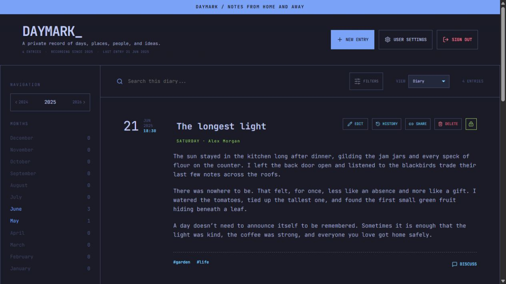
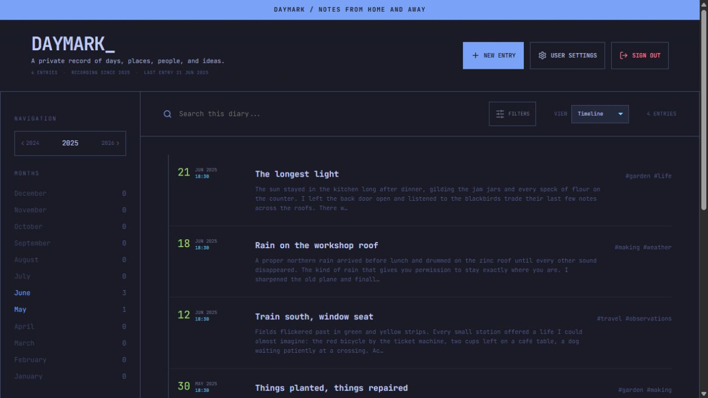
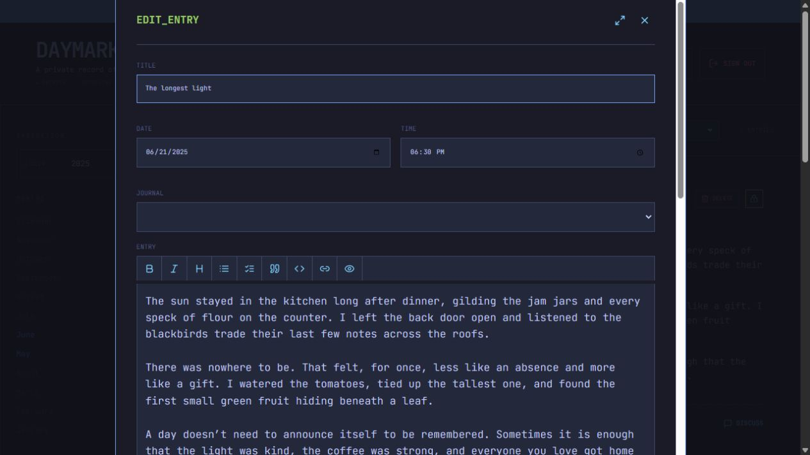

<div align="center">

# Daymark

**Your days, in your own words.**

A self-hosted diary for memories, places, people, and ideas.

[](LICENSE)
[](#quick-start)

[Get started](#quick-start) · [Screenshots](#screenshots) · [Deployment guide](DEPLOYMENT.md) · [Changelog](CHANGELOG.md)

</div>



Daymark gives you a place to write, collect photos and recordings, and revisit the moments that matter. Run it on your own server, keep entries private, or share selected memories with others.

## What you can do

| | Features |
| --- | --- |
| **Write** | Markdown, drafts, writing prompts, templates, and entry revision history. |
| **Collect** | Photos, video, audio, documents, voice notes, and links alongside your writing. |
| **Rediscover** | Search, tags, journals, calendar, timeline, gallery, maps, and statistics. |
| **Share** | Multiple accounts, shared journals, comments, and expiring sharing links. |
| **Protect** | Private entries, optional text encryption, two-factor authentication, and passkeys. |
| **Take it with you** | An installable web app, offline drafts, exports, and backups. |

## Screenshots

Screenshots show the real interface with fictional sample entries.

### A timeline of your days

Browse your journal chronologically and jump back into a memory.



### Space to write

Format your entry, choose its date, and add tags, media, or a location.



## Quick start

**You need:** Docker Engine with Docker Compose, or Docker Desktop.

### 1. Get Daymark

```sh
git clone https://github.com/donishki/Daymark.git
cd Daymark
```

You can also clone from [Gitea](https://git.ptbox.org/dasp/Daymark).

### 2. Set your secrets

Copy `.env.example` to `.env`:

```sh
cp .env.example .env
```

On Windows PowerShell, use `Copy-Item .env.example .env`.

Open `.env` in a text editor and fill in all three values with **different, strong random secrets**:

```dotenv
DB_PASSWORD=
MINIO_PASSWORD=
AUTH_ENCRYPTION_KEY=
```

Keep this file safe. You will need the same values when restoring your installation.

### 3. Start the app

```sh
docker compose up -d --build
```

Open **[localhost:3000](http://localhost:3000)** and create your account. The first account becomes the administrator.

Installing on another machine? Replace `localhost` with that server's address.

> **Before going online:** configure HTTPS, set `COOKIE_SECURE` to `true`, and configure production email delivery. The included Mailpit inbox at port `8025` is for testing. See the [deployment guide](DEPLOYMENT.md) for Portainer, configuration, and backups.

## Everyday commands

```sh
# Check service status
docker compose ps

# View application logs
docker compose logs -f diary

# Stop the services while keeping your data
docker compose down
```

For updates, back up your data first, then pull the latest code and rebuild:

```sh
git pull --ff-only
docker compose up -d --build
```

## Development

Use **Node.js 22.12+**.

```sh
npm ci
npm run dev
```

The API requires PostgreSQL, MinIO, and the environment settings described in the [deployment guide](DEPLOYMENT.md). Use Docker Compose for a complete local stack.

Build the frontend with `npm run build`.

## Links

[GitHub](https://github.com/donishki/Daymark) · [Gitea](https://git.ptbox.org/dasp/Daymark) · [Report an issue](https://github.com/donishki/Daymark/issues) · [Planned improvements](TODO.md)

## License

Copyright © 2026 Dario P.

Daymark is licensed under the **GNU General Public License v3.0** (`GPL-3.0-only`). See [LICENSE](LICENSE) for the full terms.
